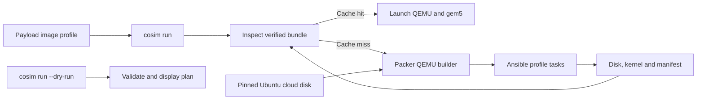

[中文](../zh/rocm-image.md)

<!--
SPDX-License-Identifier: Apache-2.0
-->

# Guest Image Profiles

Guest image recipes live in `resources/images/profiles/`, organized by role,
distribution, release and architecture. The first profile is
`guest/ubuntu/24.04/x86_64/rocm7_0`. Its payload selects the profile while the
machine topology continues to describe hardware only.



The profile starts from Ubuntu 24.04's [2026-08-26 cloud image release](https://cloud-images.ubuntu.com/releases/noble/release-20260826/).
Its SHA-256 is stored in `profile.toml`. Packer's [QEMU builder](https://developer.hashicorp.com/packer/integrations/hashicorp/qemu/latest/components/builder/qemu)
sets `disk_image = true`, creates a standalone QCOW2 image, boots it with QEMU
and provides the temporary SSH key through cloud-init. The Packer [Ansible
provisioner](https://developer.hashicorp.com/packer/integrations/hashicorp/ansible/latest/components/provisioner/ansible)
installs the
selected kernel packages, ROCm, PyTorch and cosim services, builds the gem5 WMI
module, and exports the matching kernel and package inventory. The shared
Packer template and Ansible entry point are in `resources/images/packer/` and
`resources/images/ansible/`; the profile contains its OS and package data.

`gem5-resources` remains under `third_party/` for inputs that are still used by
the ROCm guest and GPU examples, including ROM and discovery firmware files.
The profile recipe, Packer template and Ansible tasks are maintained in this
repository. The `gem5` submodule builds the `m5` utility and simulator; the
`qemu` submodule provides the QEMU build used by co-simulation.

## Build and inspect

Image construction requires Linux x86_64, `/dev/kvm`, QEMU, `qemu-img`,
`readelf`, Python 3 with `venv`, and enough free disk space for the 56 GB guest
disk. The image command downloads pinned Packer 1.16.1 and installs pinned
Ansible Core 2.18.6 under `build/tools/`. Packer downloads and plugins are kept
under `build/cache/`; logs, temporary files and final image artifacts stay
under `build/`.

Build and verify the ROCm profile with:

```bash
just build-rocm-assets
just test-rocm-assets
```

The Bash entry `scripts/cosim-image` supports listing, validating, building and
verifying profiles without the simulator launcher. `cosim run --dry-run`
validates the selected profile and topology, reports the resolved commands and
whether it would build or reuse the image, and exits without writing files or
starting QEMU or gem5. A normal `cosim run` builds on a cache miss, verifies the
bundle, then validates its kernel and disk before launching.

The verified bundle is stored under
`build/images/guest/ubuntu/24.04/x86_64/rocm7_0/`. It contains `disk`, the
matching `kernel`, package inventories, build logs and `manifest.json`. The
manifest records the pinned base image, profile files, external firmware and
`m5` inputs, QEMU and QEMU image tool versions, Packer and Ansible versions,
and SHA-256 values for each artifact. QCOW2 bundles must pass `qemu-img check`
and must not depend on a backing file. A profile or input change creates a new
input identity; a matching verified bundle is reused.

## CI evidence

The image job builds `m5`, validates the Packer and Ansible configuration,
checks for a retained bundle with the same input identity, and builds only when
no valid bundle is available. It publishes the disk, kernel and manifest as a
workflow artifact. The integration job downloads and verifies that bundle,
then runs the ROCm guest regression through the Rust launcher. The gem5 binary
uses its separate build cache. Image and simulator inputs are verified before
the guest starts; the workload results and build diagnostics are retained as
CI artifacts.
