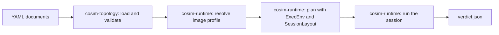
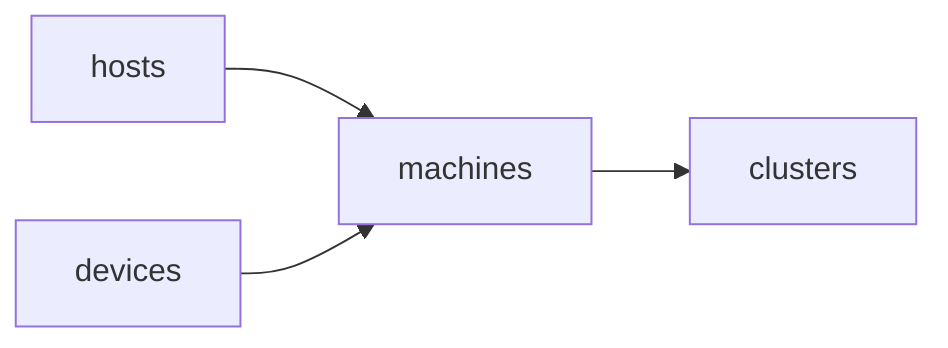
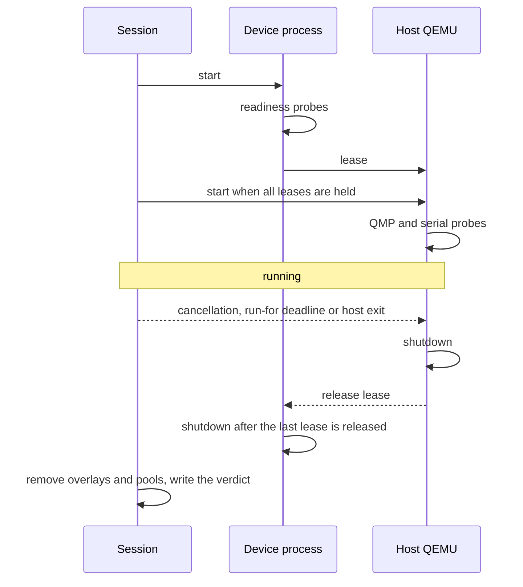

[中文](../zh/topology.md)

<!--
SPDX-License-Identifier: Apache-2.0
-->

# Topology and runtime

A YAML topology describes machines. Each machine has one QEMU host, the device
processes connected to it through vfio-user, and one shared memory pool. The
`cosim` launcher turns the description into a plan for the local system and
supervises the processes.



- `cosim-topology` reads only the YAML documents. Its result does not depend
  on the system that will run it.
- `cosim-runtime` adds host facts (page size, `PATH`, disk lock directory)
  and session paths, then creates resources and processes.
- `cosim-cli` provides the commands, signal handling and terminal output.

## Documents

A topology document contains `version: 1` and any of `imports`, `templates`,
`kinds` and `machines`.

```yaml
version: 1
imports:
  - hosts/qemu.yaml
  - devices/gpu/mi300x.yaml
  - devices/pci/qemu-edu.yaml
machines:
  - id: m0
    host: {use: host-x86, memory: 32G}
    devices:
      - {use: mi300x, count: 2}
      - {use: qemu-edu, count: 2}
```

Unknown fields are errors. `cosim schema` prints the JSON Schema of the format.
Guest boot and storage inputs live in a separate payload document. Select it
with `--payload samples/payloads/ubuntu-rocm7_0.yaml` for `validate` or `run`;
the same payload applies to every machine in the topology. `cosim run --dry-run`
checks the payload and selected image profile, displays the resolved launch
plan and cache status, and performs no build or launch.

A payload may set `image.profile` to a profile under
`resources/images/profiles/`. The profile supplies its boot kernel and root
disk. A normal `cosim run` builds the profile on a cache miss, verifies its
manifest, then checks assets and launches the topology.

### Imports and templates

- Imports resolve against the importing file, then against the `--samples`
  directory (default `samples/`). The `#templates` suffix is accepted.
- Imported files contribute templates, kinds and further imports. Only the
  top-level document contributes runnable machines.
- `use` selects a template. Mappings merge recursively, sequences are
  replaced and explicit values override template values.
- Import cycles, template cycles, duplicate template or kind names and
  unknown references are errors. A file reached through several imports is
  loaded once.
- Inside `samples/`, `hosts/` and `devices/` import nothing, `machines/`
  imports `hosts/` and `devices/`, and `clusters/` imports `machines/`.



Resource paths are relative to the workspace root: executables containing `/`,
device `config` and `pci.rom`, payload `boot.kernel` and `boot.initrd`, disk
`path` and `backing`, and the profile identifier under `image.profile`.
Relative paths cannot contain `..`; absolute paths are accepted. Bare
executable names are searched in `PATH` during planning.
`scripts/dev.sh` sets `COSIM_WORKSPACE` to the repository root. Direct `cosim`
invocations use the current directory by default; set `COSIM_WORKSPACE` to
select another workspace root. YAML resource values contain paths such as
`build/qemu/qemu-system-x86_64` without a workspace variable prefix.

### Machines and identifiers

- `count` expands `id: m, count: 4` into `m0` to `m3`. At most 4096 machines
  are allowed.
- Device identifiers default to the `use` name or kind followed by an index,
  such as `mi300x-0`. An explicit `id` is kept when its count is one.
- Identifiers use 1 to 48 letters, digits, underscores and hyphens.
  Machine, device and disk identifiers must differ in more than ASCII case.
- The machine identifier `memory` and the device identifiers `host`, `qmp`
  and `serial` are reserved by the session layout.
- `placement.agent` names a remote agent for distributed execution; `cosim run`
  rejects remote placement, and switch nodes are not part of the format yet.

### Hosts

A host declares its adapter `kind`, `runtime.binary` and `runtime.env`,
`memory`, `cpus`, `accel` and `machine`. Optional fields are `cpu`, `display`,
`monitor`, `no_reboot`, `memory_align`, `memory_map`, `serial` and `args`.

- `samples/hosts/qemu.yaml` declares the `qemu-host` kind. Its command
  template binds the memory pool, exposes QMP and the serial console, gives
  every device its own PCIe root port at slots `0x10`-`0x17`, then attaches
  disks, which QEMU places in the remaining slots.
  The kind declares `max_devices: 64`; a machine may not exceed the
  `max_devices` of its host kind.
- `host-x86` describes the x86_64 PCI hole in `memory_map`; `host-arm`
  places RAM at `0x40000000`. `memory_map` is a MiniJinja template that
  receives `host` and `ram.size` and renders ordered, non-overlapping
  `{start, size}` ranges that cover `memory` exactly.
- Current QEMU host profiles cover x86_64 and ARM64. The build recipes do not
  yet support a RISC-V host profile.
- `serial.wait_for` adds a serial readiness marker; `serial.timeout` gives
  it a deadline in seconds, measured from host start.

### Payload and disks

The separate payload YAML contains optional `boot` (`kernel`, `initrd`, and
`cmdline`), `disks`, and `snapshot` fields. A payload is shared by all machines
in a topology. Hardware-only topologies can omit it. A topology with a device
`guest_hints.cmdline` requires a payload with `boot.kernel`. `boot.kernel`
enables direct kernel boot; host profiles describe hardware and QEMU settings.

### Devices

`kind` selects the launch contract and the model:

- `gem5-mi300x` runs `mi300_cosim.py` with one GPU per process. It needs
  `config`, exactly one `vram` region whose size is a power of two, and a host
  `memory_map`. `args` accepts `num_compute_units` (1 to 1024, default 40),
  `gem5_debug_flags` and `extra`. PCI metadata, when given, must match MI300X
  (`0x1002:0x74a0`, 256 MSI-X vectors). The binary defaults to `gem5.opt`.
- `qemu-device` runs QEMU with `-machine x-remote` and an
  `x-vfio-user-server` object. `args.device` holds the QEMU device properties
  and needs `driver`; its `id` defaults to `device0`. `args.extra` adds QEMU
  arguments. It needs `runtime.binary` and accepts no private regions.
- A kind declared under `kinds` with `role: device` provides `argv` or
  `command`. `runtime.argv` or `runtime.command` replaces the command of any
  device. Such commands need `ready_log`, a message the device prints after it
  listens.

An optional `pci.rom` supplies the host-side PCI option ROM. The QEMU host
template passes it as the vfio-user client's `romfile`; its bytes are exposed
through that device's ROM BAR. The launcher checks that the file exists before
allocating session resources. The MI300X template selects its matching resource
file, and each device can override that path.

Device templates receive `id`, `machine`, `socket`, `pool`, `ram`, `regions`,
`guest_ranges`, `args`, `config`, `model`, `run_dir` and `node_dir`. Host
templates receive `host`, `machine`, `pool`, `ram`, `guest_ranges`, `boot`, `disks`,
`devices`, `qmp`, `serial`, `serial_log`, `cmdline`, `run_dir` and
`node_dir`. Regions expose `offset`, `size` and `align`. Undefined template
values are errors.

Every host and device program must stay in the foreground, keep its resource
users in its process group and keep inherited file descriptors open. QEMU
`-daemonize` is rejected.

### Memory layout

Each machine has one pool file. Guest RAM comes first and device regions
follow in declaration order. Sizes accept integers or binary units such as
`32G`. Each region size must be a multiple of the execution page size, and
alignments are powers of two of at least one page; the default alignment is
2 MiB. For a 32 GiB host with eight 8 GiB VRAM regions the pool is 96 GiB,
with `mi300x-0.vram` at 32 GiB and `mi300x-7.vram` at 88 GiB.

QEMU maps guest RAM through `memory-backend-file` with `share=on`. gem5
receives `--shared-pool`, `--pool-vram-offset` and `--host-memory-ranges`
and maps the same file. QEMU device servers receive guest RAM through
vfio-user DMA mappings.

### Disks

Each disk declares exactly one of `path` or `backing`, a `format` (`raw` or
`qcow2`, default `qcow2`) and a `bus` (`virtio`, `nvme`, `ide` or `scsi`).

- `readonly: true` opens the source read-only.
- `readonly: false` requires `shared: false`. Such a disk writes `path`
  directly, or a per-machine qcow2 overlay in the session directory when the
  disk declares `backing` or the payload sets `snapshot: true`.
- A disk without `readonly` writes a per-machine qcow2 overlay in the session
  directory. `shared: true` requires `readonly: true`.
- `create: true` with `size` creates a missing `path` with `qemu-img`; the
  image is formatted under a temporary name and published with a link that
  never replaces an image created concurrently.
- A direct writer cannot share its image with other disks of the topology,
  and creation requests for one path must agree on size and format.

## Planning

`cosim run --dry-run <yaml>` validates the topology and payload, then prints the
resolved executables, arguments, environments, readiness probes, memory
layouts, disk targets and image cache action. It performs no build or launch.

- `ExecEnv` records the page size, an absolute `PATH` and the disk lock
  directory (`COSIM_DISK_LOCK_DIR`, default `~/.cache/cosim-gpu/disk-locks`).
  Lock files outlive sessions, so the lock directory must be outside the pool
  directory. Processes receive only `runtime.env`, plus `PATH` and a default
  `LANG=C`.
- `SessionLayout` names every session path. The run directory defaults to
  `.cosim/<name>`. On Linux the pool directory defaults to
  `/dev/shm/cosim-<name>-<hash>`, where the hash identifies the absolute run
  directory; other systems use `<run-dir>/memory`. The existing part of each
  directory path is resolved through symbolic links before the layout checks
  how the run and pool directories nest.
- Processes are ordered so that each device precedes its host, and the host
  depends on its devices.

## Running a session



- The run directory is prepared under a temporary name with a held
  `session.lock`, complete `manifest.json`, `plan.json` and `options.json`.
  It is published with one rename before any external resource is created.
  Then the session creates the pool directory, reserves each pool's storage
  and prepares the disks of each machine. The pool directory is prepared under a
  temporary name with its ownership marker and renamed into place without
  replacing an existing directory, so it never appears without the marker.
- A process starts when every dependency is ready. Probes run in order:
  output-log markers, socket existence and QMP negotiation; the host also
  waits for `serial.wait_for`. Each probe must succeed within
  `--ready-timeout` of the process start, or within `serial.timeout` for the
  serial marker when it is set.
- A ready device hands a lease to each dependent and stops after the last
  lease is released, so hosts always stop before their devices. Machines do
  not wait for each other.
- A host that exits with status 0 ends its machine. Any other exit, a failed
  probe or a failed disk preparation cancels the session. Cancellation during
  disk preparation stops `qemu-img` and ends the session without a failure.
- The first SIGINT or SIGTERM starts graceful shutdown; a further signal skips
  remaining grace periods. `--run-for` ends the session after every process is
  ready. With `--stdin-lifeline` (set by the development container), closing
  standard input also ends the session.
- Each process group receives SIGTERM, five seconds to exit, then SIGKILL.
  Children start through `setpriv --pdeathsig KILL`, so they die with the
  launcher. `cosim run` requires Linux with glibc and `setpriv`.
- After every process has stopped, sockets, overlays, pools and the pool
  directory are removed; logs remain. If termination cannot be confirmed,
  resources are kept and `verdict.json` records `users_stopped: false`.
- The run directory keeps `plan.json`, `options.json`, `manifest.json`,
  per-machine `layout.json`, process `output.log` files, serial logs and
  `verdict.json`. The final `[COSIM_VERDICT]` line repeats the verdict.
- Lock descriptors are close-on-exec, and each session passes its own locks
  to the processes it starts: every process and `qemu-img` helper receives
  `session.lock`, each host also receives the image leases of its machine,
  and an overlay helper receives the lease of its backing image.
- `cosim clean <run-dir>` removes the resources listed in `manifest.json`
  after the launcher was killed or exited abnormally. It proceeds only after
  the launcher and all of its processes, including forked workers, have
  exited and released `session.lock`. It removes pools only from a pool
  directory whose ownership marker names the session, and leaves a directory
  that another session published under the same name.
- Image leases in the shared lock directory are keyed by device and inode, so
  a direct writer excludes other sessions even through links. A lease lasts
  while the launcher or a host or helper that may use the image is alive.

## Development container

The recipes that build QEMU, gem5, m5 and `cosim`, run topologies and run the
Rust checks use `scripts/dev.sh`. They run natively on Linux when the
dependencies are installed. Other systems, or Linux with `COSIM_ENV=container`,
use a temporary container:

- `just dev-image` builds `cosim-dev:local` from `scripts/Dockerfile.dev`
  with the gem5 and QEMU build dependencies, Rust, QEMU and `qemu-img`.
- `scripts/dev.sh` runs the command of such a recipe in
  `docker run --rm --init`. The source tree is mounted at its host path, so
  paths in YAML, plans and logs are identical inside and outside. Files
  outside the source tree are not visible, except the disk lock directory and
  directories passed with `--mount`.
- The container uses its own `/dev/shm`, sized to the Docker daemon's memory;
  pools disappear with the container. `/dev/kvm` is passed through when
  present.
- When the launcher exits for any reason, the container's init process exits
  and the kernel stops every remaining process in it.
- Outside `--tty` mode, `dev.sh` keeps the container's standard input open
  while its Docker client runs and sets `COSIM_STDIN_LIFELINE=1`, so the
  launcher stops when the client disappears.
- Build products, including Cargo output and caches, go under the repository's
  top-level `build/` directory.
- `just dev-shell` opens a shell in a temporary container. Each container is
  named `cosim-dev-<random>` for `docker exec`.

## Commands

```bash
just dev-image                       # outside Linux, or with COSIM_ENV=container
just build-cosim
just run-cli validate samples/machines/gpu-8.yaml --payload samples/payloads/ubuntu-rocm7_0.yaml --assets
just run-cli plan samples/machines/mixed-models.yaml --payload samples/payloads/ubuntu-rocm7_0.yaml
just run-cli graph samples/clusters/cluster-4x8.yaml
just run-cli schema
just run-topology samples/machines/single-gpu.yaml --payload samples/payloads/ubuntu-rocm7_0.yaml
just run-topology-dev samples/machines/host-only.yaml --run-for 1
just run-cli clean .cosim/<name>
just check-cosim
just test-cosim-integration
just build-qemu && just test-cosim-vfio-user
```

`samples/machines/gem5-aarch64.yaml` runs the native ARM64 gem5 build with a
paused ARM64 host. The supplied Ubuntu/ROCm guest image targets x86_64.
`configs/sst/` holds separate SST network experiments.
