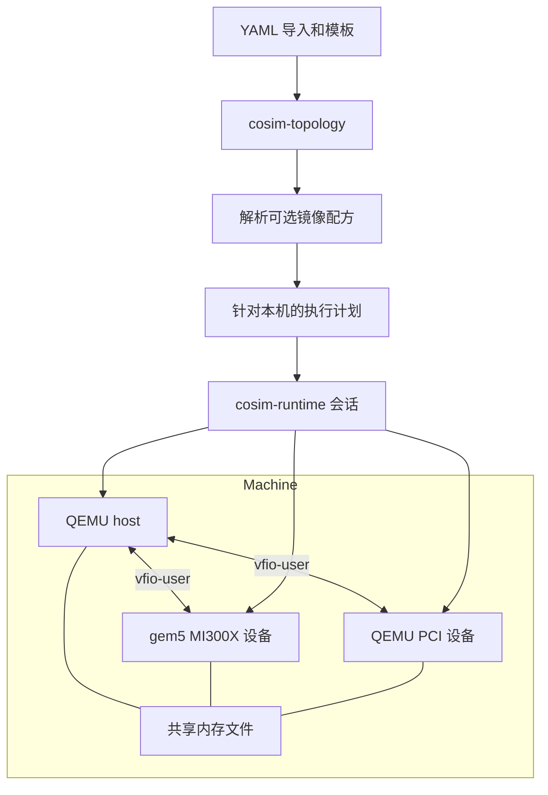
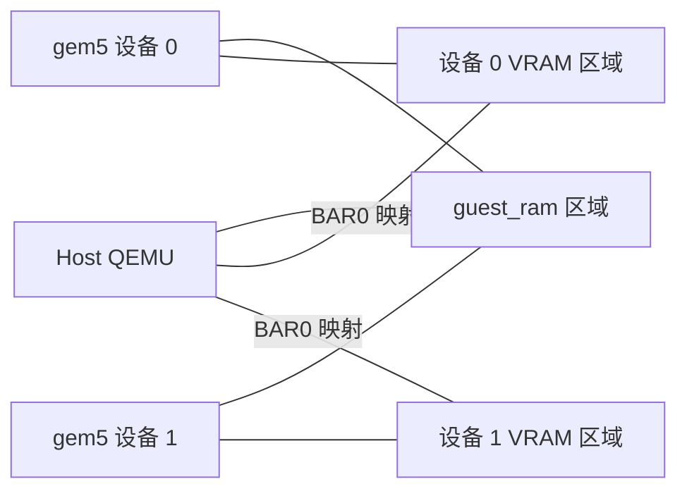
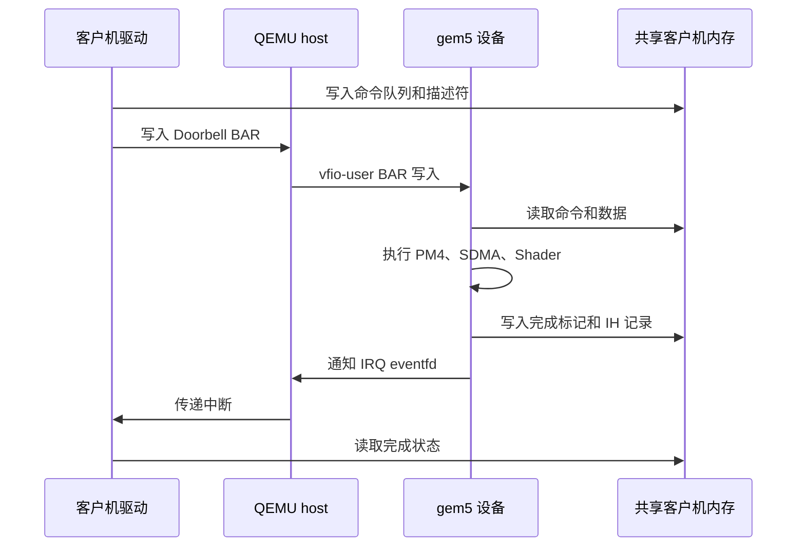

[English](../en/architecture.md)

# 联合仿真架构

## 机器与设备模型

Rust 程序 `cosim` 读取 YAML 拓扑，管理每台机器的 host QEMU、设备进程、共享内存
和磁盘覆盖层。设备模型使用 gem5 或 QEMU，在执行环境（Linux 主机或开发容器）中
以原生进程运行。每个设备通过独立的 vfio-user Unix socket 连接所属机器的 host。
每台机器拥有一个共享内存文件。

`cosim-topology` 负责文档解析、校验、模板展开、内存布局和参数渲染，只读取 YAML 文档。
`cosim-runtime` 负责针对本机生成执行计划、运行与清理，`cosim-cli` 提供命令行接口。
[拓扑文档](topology.md) 定义各字段和运行生命周期。

host QEMU 运行客户机 Linux、amdgpu 驱动和 ROCm 程序。gem5 运行 MI300X
命令处理器、Shader/CU、SDMA 和 Ruby 内存层次结构。其联合仿真配置使用
`StubWorkload` 执行设备模型。QEMU 设备进程使用 `x-remote` 和
`x-vfio-user-server` 提供 PCI 设备。host QEMU 与设备 QEMU 分别拥有自己的
命令行参数和生命周期。

每个进程运行在独立的进程组中，并通过 `setpriv --pdeathsig KILL` 启动。设备通过
就绪探测后才启动 host；host 随后完成 QMP 握手，并可选择等待指定的客户机串口输出。
host 先于设备停止。

## Rust 模块与接口

工作区包含三个 crate。`cosim-cli` 依赖 `cosim-topology` 和 `cosim-runtime`，
`cosim-runtime` 依赖 `cosim-topology`。

- `cosim-cli/src/main.rs`：Clap 命令 `validate`、`graph`、`schema`、`run` 和
  `clean`；`run --dry-run` 检查镜像缓存并打印计划，普通运行会先构建或复用配方产物。
- `cosim-topology/src/raw.rs`、`model.rs`、`size.rs`：解码得到的输入类型、校验后的
  类型（`Topology`、`Machine`、`Host`、`Device`、`Disk`）和 `ByteSize`。
- `cosim-topology/src/loader.rs`、`resolve.rs`：导入、合并键、模板继承、工作区相对
  资源路径、数量展开和校验。
- `cosim-topology/src/adapter/`：`Adapter` enum 及 `gem5-mi300x`、`qemu-device` 和
  模板适配器，host 参数渲染和 `Probe`。
- `cosim-topology/src/layout.rs`：给定 `PageSize` 时的内存池和客户机物理地址区间。
- `cosim-runtime/src/env.rs`、`layout.rs`、`plan.rs`：`ExecEnv`、`SessionLayout` 和
  可序列化的 `Plan`。
- `cosim-runtime/src/session.rs`、`node.rs`、`probe.rs`：会话资源、节点类型状态、
  依赖租约、就绪探测和 verdict。
- `cosim-runtime/src/process.rs`、`resource.rs`、`disk.rs`：进程组、文件和锁的所有者、
  镜像创建、租约和 overlay。
- `cosim-runtime/src/manifest.rs`、`assets.rs`：launcher 被杀死或异常退出后的 `cosim clean`
  以及本地输入文件检查。
- `cosim-runtime/src/images.rs`：调用统一的镜像配方工具，把验证后的磁盘及可选内核
  加入 payload。
- `resources/images/`：共享 Packer/QEMU 模板、Ansible 入口和按操作系统组织的配方。
  `scripts/cosim-image` 允许 Bash 调用相同的构建和校验接口，不启动模拟器。

拓扑库公开 `load`、`graph`、`schema`，校验后的类型根据 `DeviceContext` 和
`HostContext` 渲染启动参数。运行库公开 `plan`、`run`、`clean`、`check_assets`、
`RunOptions`、`Shutdown` 和 `Event`。执行计划记录程序、参数、环境、依赖、就绪探测、
共享内存区域、磁盘目标以及锁文件路径。

YAML 语法与合并键由 `serde_yaml_ng` 处理，Serde 负责类型反序列化。
MiniJinja 渲染参数模板，Schemars 生成 JSON Schema，`parse-size` 解析大小表达式。
Tokio 在单个线程上运行会话，`futures-util` 并发推进各进程节点，`nix` 提供进程组
信号、页大小和文件系统统计接口。项目的 Rust crate 从工作区继承
`unsafe_code = "forbid"`。

host-x86、host-arm 等架构 profile、CPU、内存、启动镜像和 QEMU 参数策略通过 YAML 配置。
规划阶段据此计算共享文件偏移和连接路径。gem5 与 QEMU 直接交换 vfio-user 消息，
Rust 通过 QMP 检查就绪状态并管理进程资源。交换机节点是设计中的预留部分；远程
placement 可以在配置中描述，本地执行器会在分配资源前拒绝执行。

## vfio-user 接口

QEMU 的 `vfio-user-pci` 是 host 客户端。gem5 的 `MI300XVfioUser` 使用
libvfio-user 提供配置空间、BAR、DMA 映射和中断。QEMU 设备模型通过
`x-vfio-user-server` 提供相同协议。

| 操作 | 接口 |
|---|---|
| PCI 配置空间与 MMIO | vfio-user 消息 |
| Doorbell 访问 | 设备 BAR 回调 |
| 客户机内存共享 | 携带文件描述符和文件偏移的 DMA_MAP |
| 可映射的 BAR 区域 | 区域文件描述符与 mmap 偏移 |
| MSI-X 中断 | IRQ eventfd 注册和通知 |

Unix socket 与共享文件映射要求 host 和设备进程在同一系统运行。
设备模型实现 PCIe 访问、设备间通信和仿真时间行为。运行管理程序负责进程连接
与资源管理。

## MI300X PCI 接口

MI300X 的厂商 ID 为 `0x1002`，设备 ID 为 `0x74a0`。
设备模型提供 PCI 配置空间，并向 QEMU 声明 BAR 布局。

| BAR | 内容 | 大小与表示方式 |
|---|---|---|
| 0 + 1 | VRAM | 可配置的二次幂大小；64 位可预取区域 |
| 2 + 3 | Doorbell | 4 MiB；64 位 BAR |
| 4 | MSI-X | 256 个向量 |
| 5 | MMIO 寄存器 | 512 KiB；32 位 BAR |

驱动要求 VRAM 位于 BAR0，Doorbell 位于 BAR2，MMIO 位于 BAR5。
64 位 BAR 的高位部分参与大小探测。设备能力需要在 vfio-user 上下文完成初始化前
注册。客户机的 ROM 和驱动初始化由 `cosim-gpu-setup.service` 提供。

## 共享内存

启动进程前，运行管理程序计算每台机器的内存布局。客户机内存位于第一个区域，
设备区域按指定的字节边界依次排列。每个区域的名称、偏移和大小记录在
`layout.json` 中。

这些区域位于同一个文件中。QEMU 的 `memory-backend-file` 使用 `share=on`
映射客户机内存。gem5 接收文件路径和 VRAM 偏移，其 `PhysicalMemory` 映射
分配到的客户机内存与设备内存，检查区域大小，并保留外部文件原有长度。
`MI300XVfioUser` 使用相同的 VRAM 文件偏移调用 `vfu_setup_region`，使 QEMU
与 gem5 通过 BAR 映射访问同一组字节。

启动器在启动任何模拟器之前，为每个共享内存文件预留存储容量。
并发会话在准备阶段占用文件系统的可用容量，预留失败时释放该会话的资源。
启动器创建和删除共享内存文件。设备进程解除自身映射并关闭描述符。
shell 启动接口继续使用其 POSIX 共享内存参数。

客户机内存保存命令队列、完成标记、中断记录、队列描述符和 DMA 数据。
VRAM 保存设备分配、发现信息和 GPU 页表。双方通过共同的文件访问数据，
访问顺序、缓存行为和同步语义由设备模型与客户机软件处理。

### 客户机物理地址布局

外部 host 模板通过 `memory_map` 声明物理 RAM 区域。Rust 校验区域顺序、页边界和
总大小，计算连续的文件偏移，再通过 `--host-memory-ranges` 把 JSON 数据传给 gem5。

| host 配置与客户机地址区域 | 共享内存文件偏移 |
|---|---|
| Q35：`[0, below_4g)` | 从零开始 |
| Q35：`[4 GiB, 4 GiB + above_4g)` | 从 `below_4g` 开始 |
| AArch64 virt：`[1 GiB, 1 GiB + ram_size)` | 从零开始 |

PCI 地址空洞不占用共享内存文件中的字节。VRAM 区域位于完整客户机内存之后。
客户机物理地址和文件偏移分别记录。ARM64 硬件使用 `qemu-system-aarch64`，
x86_64 硬件使用 `qemu-system-x86_64`。gem5 的 `VEGA_X86` 模型配置可以编译为
对应 Linux 执行架构的原生程序。

## GPU 地址翻译

`AMDGPUVM` 提供 AGP、GART、MMHUB 和用户上下文地址翻译。
驱动通过 MMIO 设置地址窗口寄存器与页表基址。

| 地址类型 | 翻译方式 |
|---|---|
| AGP | `physical = virtual - agpBot + agpBase` |
| VMID 0 GART | 单级 GPU 页表 |
| Framebuffer | 设备内部 VRAM 偏移 |
| MMHUB | VRAM 地址窗口偏移 |
| VMID 大于零 | 当前上下文的多级页表遍历 |

相关寄存器状态包括 `fbBase`、`fbTop`、`fbOffset`、`agpBase`、`agpBot`、
`agpTop`、`sysAddrL`、`sysAddrH`、`ptBase`、`ptStart` 和 `ptEnd`。
具体存储方式与寄存器数值转换由 `third_party/gem5/src/dev/amdgpu/amdgpu_vm.cc` 实现。

每个 GART 页表项占八个字节。GPU 页对应的表内偏移由相对于地址窗口的页索引计算。
PM4 和 SDMA 在其翻译接口需要编码后的页表地址时调用 `getGARTAddr()`。
物理页地址与原始页面内偏移共同构成翻译后的物理地址。

客户机可以通过 QEMU 映射的 VRAM BAR 更新页表。gem5 联合仿真的翻译路径读取
共享 VRAM，并处理以 framebuffer 为基准的页表地址。用户上下文通过
`VegaISA::Walker` 遍历页表，配合模型中的 TLB 失效处理。
运行管理程序提供正确的映射偏移与大小，GPU 模型处理地址分类和页面故障。

## 命令、DMA 与中断

PM4 和 SDMA 根据地址与 VM 上下文选择设备内存或系统内存路径。
系统内存操作访问共享客户机内存，设备内存操作通过 GPU 内存管理器访问分配到的
VRAM。共享文件提供内存模型的数据存储，Ruby 和 GPU 组件保留自身的请求处理
与缓存行为。

中断处理器写入 IH 记录，更新写指针，然后请求中断。
`AMDGPUDevice::intrPost()` 调用 `MI300XVfioUser`，触发配置的 IRQ eventfd。
使用 KVM 时，注册的 eventfd 支持向客户机注入中断。
客户机通过共享内存读取 IH 记录和完成标记。

## 设备模型互联

gem5 的 `XGMIBridge` 及相关配置实现模拟器内部的互联行为。
Python 配置也支持通过 `--num-gpus` 在单个 gem5 进程内创建多个 GPU 对象及互联。
YAML 的 MI300X 适配器为每个进程启动一个 GPU，并分配一个 VRAM 区域。

`configs/sst/multi_node_topology.py` 描述 SST 网络参数。
`configs/sst/mi300x_merlin_poc.py` 提供 SST 集成实验。
这些配置依赖相应模拟器组件，并具有独立于 Rust 进程管理的接口。

## 源码接口

| 文件或目录 | 职责 |
|---|---|
| `crates/cosim-topology/src/` | YAML 文档、校验后的类型、内存布局与适配器 |
| `crates/cosim-runtime/src/` | 执行计划、进程监督、资源所有权与清理 |
| `third_party/gem5/configs/example/gpufs/mi300_cosim.py` | MI300X 对象和共享文件参数 |
| `third_party/gem5/src/mem/physical.{cc,hh}` | 物理内存存储与边界检查 |
| `third_party/gem5/src/dev/amdgpu/mi300x_vfio_user.{cc,hh}` | BAR、配置空间与 IRQ 协议处理 |
| `third_party/gem5/src/dev/amdgpu/amdgpu_vm.{cc,hh}` | 地址翻译 |
| `third_party/gem5/src/dev/amdgpu/pm4_packet_processor.{cc,hh}` | PM4 命令处理 |
| `third_party/gem5/src/dev/amdgpu/sdma_engine.{cc,hh}` | SDMA 执行 |
| `third_party/gem5/src/dev/amdgpu/interrupt_handler.cc` | IH 记录与中断 |
| `third_party/qemu/hw/remote/vfio-user-obj.c` | QEMU 设备服务端接口 |
