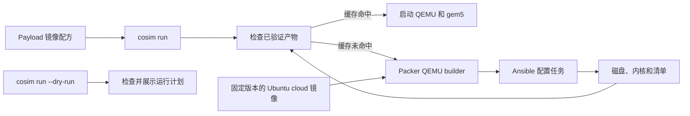

[English](../en/rocm-image.md)

<!--
SPDX-License-Identifier: Apache-2.0
-->

# Guest 镜像配方

Guest 镜像配方放在 `resources/images/profiles/`，按角色、发行版、版本和架构组织。
当前首个配方是 `guest/ubuntu/24.04/x86_64/rocm7_0`。payload 负责选择配方，机器
拓扑继续描述硬件。



配方以 Ubuntu 24.04 在 [2026-08-26 发布的 cloud 镜像](https://cloud-images.ubuntu.com/releases/noble/release-20260826/)为基础，固定校验值保存在
`profile.toml`。Packer 的 [QEMU builder](https://developer.hashicorp.com/packer/integrations/hashicorp/qemu/latest/components/builder/qemu)
设置 `disk_image = true`，生成独立的 QCOW2 镜像，通过 QEMU 启动 Guest，并由 cloud-init
注入临时 SSH key。Packer 的 [Ansible provisioner](https://developer.hashicorp.com/packer/integrations/hashicorp/ansible/latest/components/provisioner/ansible)
安装指定的 kernel 软件包、ROCm、PyTorch 和 cosim 服务，编译 gem5 WMI 模块，并导出匹配的 kernel 与软件包清单。
共享 Packer 模板和 Ansible 入口分别位于 `resources/images/packer/` 和
`resources/images/ansible/`；配方文件保存操作系统和软件包配置。

`gem5-resources` 保留在 `third_party/`，继续提供 ROCm Guest 和 GPU 示例仍在使用的
ROM、discovery 固件等输入。配方、Packer 模板和 Ansible 任务由当前仓库维护。`gem5`
子模块用于构建 `m5` 工具和 gem5 模拟器；`qemu` 子模块提供联合仿真使用的 QEMU 构建。

## 构建和检查

镜像构建需要 Linux x86_64、`/dev/kvm`、QEMU、`qemu-img`、`readelf`、带 `venv` 的
Python 3，以及足够存放 56 GB Guest 磁盘的可用空间。镜像命令会把固定版本的
Packer 1.16.1 和 Ansible Core 2.18.6 安装到 `build/tools/`。Packer 下载和插件缓存在
`build/cache/`；日志、临时文件和最终镜像都保存在 `build/` 下。

使用以下命令构建并验证 ROCm 配方：

```bash
just build-rocm-assets
just test-rocm-assets
```

Bash 入口 `scripts/cosim-image` 可以在不启动模拟器的情况下列出、检查、构建和验证
配方。`cosim run --dry-run` 会检查选中的配方与拓扑，显示解析后的命令以及将构建还是
复用镜像，然后退出；整个过程不会写入文件，也不会启动 QEMU 或 gem5。普通
`cosim run` 在缓存未命中时构建镜像，验证镜像清单，再检查 kernel 和磁盘后启动。

验证后的 bundle 保存在
`build/images/guest/ubuntu/24.04/x86_64/rocm7_0/`，包含 `disk`、配套 `kernel`、软件包
清单、构建日志和 `manifest.json`。清单记录固定版本的基础镜像、配方文件、外部固件与
`m5` 输入、QEMU 和 QEMU 镜像工具版本、Packer 与 Ansible 版本，以及每个产物的
SHA-256。QCOW2 bundle 必须通过 `qemu-img check`，并且不能依赖 backing file。配方或
输入变化会产生新的输入标识；输入一致且校验通过的 bundle 会直接复用。

## CI 验证

镜像任务先构建 `m5`，检查 Packer 与 Ansible 配置，再查找输入标识相同的已保留镜像；
没有可用镜像时才进行构建。任务会把磁盘、kernel 和清单发布为 workflow artifact。
集成任务下载并验证 bundle，再通过 Rust launcher 运行 ROCm Guest 回归。gem5 二进制
使用独立构建缓存。Guest 启动前会检查镜像和模拟器输入；工作负载结果与构建日志会作为
CI artifact 保留。
