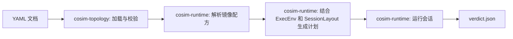
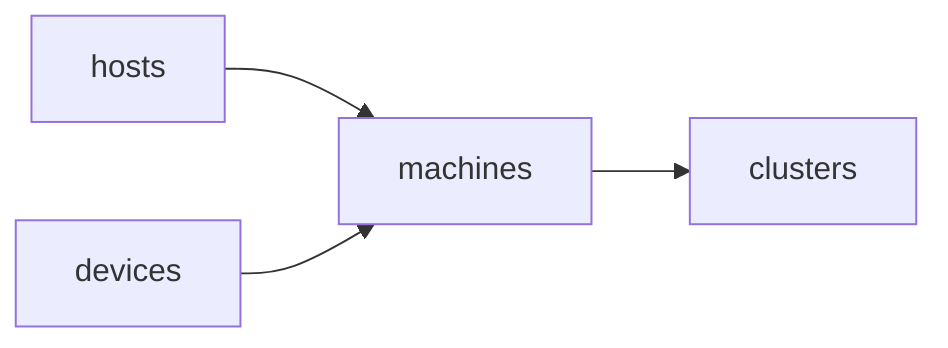
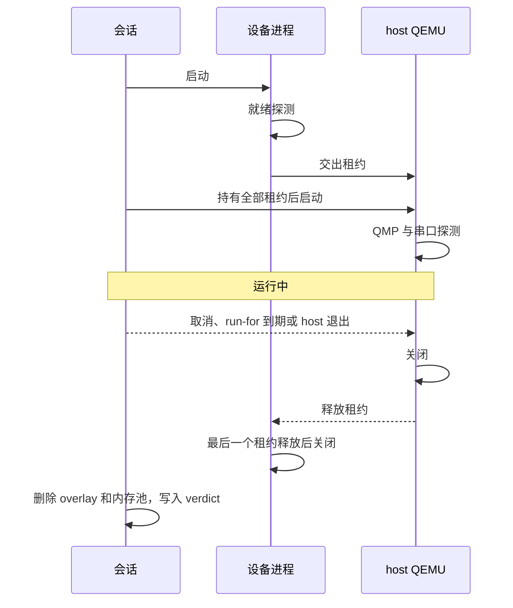

[English](../en/topology.md)

<!--
SPDX-License-Identifier: Apache-2.0
-->

# 拓扑与运行管理

YAML 拓扑描述若干台机器。每台机器包含一个 QEMU host、通过 vfio-user 连接到它的
设备进程，以及一个共享内存池。`cosim` launcher 把拓扑描述转换为针对本机的执行计划，
并监督这些进程。



- `cosim-topology` 只读取 YAML 文档，结果与执行它的系统无关。
- `cosim-runtime` 加入主机事实（页大小、`PATH`、磁盘锁目录）和会话路径，然后创建
  资源和进程。
- `cosim-cli` 提供命令、信号处理和终端输出。

## 文档

拓扑文档包含 `version: 1`，以及 `imports`、`templates`、`kinds`、`machines` 中的任意几项。

```yaml
version: 1
imports:
  - hosts/qemu.yaml
  - devices/gpu/mi300x.yaml
  - devices/pci/qemu-edu.yaml
machines:
  - id: m0
    host: {use: host-x86, memory: 32G}
    devices:
      - {use: mi300x, count: 2}
      - {use: qemu-edu, count: 2}
```

未知字段会报错。`cosim schema` 输出该格式的 JSON Schema。客户机启动和存储输入单独
保存在 payload 文档中。运行 `validate` 或 `run` 时，通过
`--payload samples/payloads/ubuntu-rocm7_0.yaml` 选择；一个 payload 会应用于拓扑中的
每台机器。`cosim run --dry-run` 会检查 payload 和所选镜像配方，显示解析后的启动计划和
缓存状态，不会构建或启动模拟器。

payload 可以通过 `image.profile` 选择 `resources/images/profiles/` 下的配方。配方提供
启动内核和根磁盘。普通 `cosim run` 会在缓存未命中时构建配方，校验 manifest，然后检查
输入文件并启动拓扑。

### 导入与模板

- 导入路径先相对于导入它的文件解析，再相对于 `--samples` 目录（默认 `samples/`）
  解析。可以使用 `#templates` 后缀。
- 被导入的文件提供模板、kind 和进一步的导入。只有顶层文档提供可运行的机器。
- `use` 选择模板。映射递归合并，序列整体替换，显式写出的值覆盖模板中的值。
- 导入循环、模板循环、重复的模板或 kind 名称以及未知引用都会报错。通过多条路径
  导入的同一文件只加载一次。
- 在 `samples/` 中，`hosts/` 和 `devices/` 不导入其他文件，`machines/` 导入
  `hosts/` 和 `devices/`，`clusters/` 导入 `machines/`。



资源路径相对于工作区根目录解析，包括含有 `/` 的可执行文件、设备 `config` 和
`pci.rom`、payload 的 `boot.kernel` 和 `boot.initrd`、磁盘的 `path` 和 `backing`，以及
`image.profile` 指定的配方标识。相对路径不能包含 `..`；绝对路径可以使用。不含 `/` 的
可执行文件名称在生成计划时从 `PATH` 中查找。`scripts/dev.sh` 会将 `COSIM_WORKSPACE` 设置为仓库根目录。直接运行
`cosim` 时默认使用当前目录；可以设置 `COSIM_WORKSPACE` 选择其他工作区。YAML 资源值
直接写 `build/qemu/qemu-system-x86_64` 这类路径，不需要添加工作区变量前缀。

### 机器与标识符

- `count` 把 `id: m, count: 4` 展开为 `m0` 到 `m3`，机器总数最多 4096 台。
- 设备标识符默认由 `use` 名称或 kind 加序号组成，例如 `mi300x-0`。显式写出的 `id`
  在 count 为 1 时保持不变。
- 标识符由 1 到 48 个字母、数字、下划线或连字符组成。机器、设备和磁盘标识符不能
  只在 ASCII 大小写上有区别。
- 机器标识符 `memory`，以及设备标识符 `host`、`qmp`、`serial` 由会话布局保留。
- `placement.agent` 指定分布式执行使用的远端 agent；`cosim run` 拒绝远端放置，
  交换机节点尚未进入该格式。

### host

host 声明适配器 `kind`、`runtime.binary` 和 `runtime.env`、`memory`、`cpus`、
`accel` 和 `machine`。可选字段包括 `cpu`、`display`、`monitor`、`no_reboot`、
`memory_align`、`memory_map`、`serial` 和 `args`。

- `samples/hosts/qemu.yaml` 声明 `qemu-host` kind。它的命令模板绑定内存池，提供
  QMP 和串口，先在插槽 `0x10`-`0x17` 为每个设备分配独立的 PCIe root port，再挂载
  磁盘，由 QEMU 把磁盘放在剩余插槽中。该 kind 声明 `max_devices: 64`，一台机器的
  设备数量不能超过其 host kind 的 `max_devices`。
- `host-x86` 在 `memory_map` 中描述 x86_64 的 PCI 空洞；`host-arm` 把内存放在
  `0x40000000`。`memory_map` 是 MiniJinja 模板，接收 `host` 和 `ram.size`，渲染出
  有序、互不重叠且正好覆盖 `memory` 的 `{start, size}` 区间。
- 当前 QEMU host profile 支持 x86_64 和 ARM64；构建 recipe 还没有 RISC-V host profile。
- `serial.wait_for` 增加串口就绪标记；`serial.timeout` 以秒为单位设置该标记的
  截止时间，从 host 启动时开始计算。

### Payload 与磁盘

独立的 payload YAML 可以包含 `boot`（`kernel`、`initrd` 和 `cmdline`）、`disks` 和
`snapshot` 字段。一个 payload 会应用于拓扑中的每台机器。仅描述硬件的拓扑可以省略
payload；包含 `guest_hints.cmdline` 的设备必须使用包含 `boot.kernel` 的 payload。
`boot.kernel` 启用直接内核启动；host profile 只描述硬件和 QEMU 设置。

### 设备

`kind` 选择启动约定和模型：

- `gem5-mi300x` 运行 `mi300_cosim.py`，每个进程一个 GPU。它需要 `config`、恰好一个
  大小为 2 的幂的 `vram` 区域，以及 host 的 `memory_map`。`args` 接受
  `num_compute_units`（1 到 1024，默认 40）、`gem5_debug_flags` 和 `extra`。给出
  PCI 元数据时必须与 MI300X 一致（`0x1002:0x74a0`，256 个 MSI-X 向量）。程序默认为
  `gem5.opt`。
- `qemu-device` 以 `-machine x-remote` 和 `x-vfio-user-server` 对象运行 QEMU。
  `args.device` 保存 QEMU 设备属性，必须包含 `driver`；其 `id` 默认为 `device0`。
  `args.extra` 追加 QEMU 参数。它需要 `runtime.binary`，不接受私有内存区域。
- 在 `kinds` 中以 `role: device` 声明的 kind 提供 `argv` 或 `command`。
  `runtime.argv` 或 `runtime.command` 可以替换任何设备的命令。这类命令需要
  `ready_log`，即设备开始监听后输出的消息。

可选字段 `pci.rom` 指定 host 侧的 PCI option ROM。QEMU host 模板将它作为
vfio-user 客户端的 `romfile`，通过该设备的 ROM BAR 提供文件内容。launcher
在分配会话资源前检查文件是否存在。MI300X 模板指定对应的资源文件，各个设备可以
覆盖这个路径。

设备模板接收 `id`、`machine`、`socket`、`pool`、`ram`、`regions`、`guest_ranges`、
`args`、`config`、`model`、`run_dir` 和 `node_dir`。host 模板接收 `host`、`machine`、
`pool`、`ram`、`guest_ranges`、`boot`、`disks`、`devices`、`qmp`、`serial`、`serial_log`、
`cmdline`、`run_dir` 和 `node_dir`。区域提供 `offset`、`size` 和 `align`。模板中的
未定义值会报错。

每个 host 和设备程序都必须在前台运行，把资源使用者保留在自己的进程组中，并保持继承的
文件描述符打开。QEMU 的 `-daemonize` 会被拒绝。

### 内存布局

每台机器有一个内存池文件。客户机内存位于开头，设备区域按声明顺序排列。大小可以
写成整数或 `32G` 这样的二进制单位。每个区域的大小必须是执行系统页大小的整数倍，
区域起始边界（`align`）必须是不小于一页的 2 的幂，默认为 2 MiB。32 GiB 内存的 host
加上 8 个 8 GiB VRAM 区域时，内存池为 96 GiB，`mi300x-0.vram` 位于 32 GiB，
`mi300x-7.vram` 位于 88 GiB。

QEMU 通过 `share=on` 的 `memory-backend-file` 映射客户机内存。gem5 接收
`--shared-pool`、`--pool-vram-offset` 和 `--host-memory-ranges`，映射同一个文件。
QEMU 设备服务端通过 vfio-user DMA 映射获得客户机内存。

### 磁盘

每个磁盘声明 `path` 或 `backing` 之一，以及 `format`（`raw` 或 `qcow2`，默认
`qcow2`）和 `bus`（`virtio`、`nvme`、`ide` 或 `scsi`）。

- `readonly: true` 以只读方式打开源镜像。
- `readonly: false` 要求同时写出 `shared: false`。这类磁盘直接写入 `path`；磁盘声明
  `backing` 或 payload 设置 `snapshot: true` 时，改为在会话目录中为每台机器写入一个
  qcow2 overlay。
- 未写出 `readonly` 的磁盘在会话目录中为每台机器写入一个 qcow2 overlay。
  `shared: true` 要求 `readonly: true`。
- `create: true` 加 `size` 使用 `qemu-img` 创建缺失的 `path`；镜像先以临时名称格式化，
  再通过链接发布，不会替换其他会话同时创建的镜像。
- 直接写入的磁盘不能与拓扑中其他磁盘共用镜像，同一路径的多个创建请求必须使用
  相同的大小和格式。

## 生成执行计划

`cosim run --dry-run <yaml>` 会校验拓扑与 payload，并显示解析后的程序、参数、环境、
就绪探测、内存布局、磁盘目标和镜像缓存操作。该命令不会构建或启动进程。

- `ExecEnv` 记录页大小、绝对路径形式的 `PATH` 和磁盘锁目录
  （`COSIM_DISK_LOCK_DIR`，默认 `~/.cache/cosim-gpu/disk-locks`）。锁文件在会话结束后
  仍然保留，因此锁目录必须位于内存池目录之外。进程只接收 `runtime.env`，以及 `PATH`
  和默认的 `LANG=C`。
- `SessionLayout` 命名所有会话路径。运行目录默认为 `.cosim/<name>`。在 Linux 上，
  内存池目录默认为 `/dev/shm/cosim-<name>-<hash>`，其中 hash 对应运行目录的绝对路径；
  其他系统使用 `<run-dir>/memory`。检查运行目录和内存池目录的包含关系之前，两个路径
  中已经存在的部分会先解析符号链接。
- 进程按顺序排列，每个设备排在它的 host 之前，host 依赖本机的全部设备。

## 运行会话



- 运行目录先以临时名称创建，持有 `session.lock`，并完整写入 `manifest.json`、
  `plan.json` 和 `options.json`。创建外部资源之前，通过一次重命名发布运行目录。
  然后创建内存池目录，为每台机器预留内存池容量并准备磁盘。内存池目录先以临时名称
  创建并写入所有权标记，再以不替换已有目录的方式重命名到正式位置，因此该目录出现时
  一定带有标记。
- 进程在全部依赖就绪后启动。探测按顺序进行：输出日志标记、socket 存在和 QMP 协商；
  host 还等待 `serial.wait_for`。每个探测必须在进程启动后 `--ready-timeout` 内成功；
  设置了 `serial.timeout` 时，串口标记使用该时限。
- 就绪的设备交给每个依赖者一个租约，最后一个租约释放后才停止，因此 host 总是先于
  设备停止。不同机器之间互不等待。
- host 以状态 0 退出时结束本机。其他退出、探测失败或磁盘准备失败会取消整个会话。
  磁盘准备期间收到的取消请求会停止 `qemu-img`，会话正常结束，不记录失败。
- 第一个 SIGINT 或 SIGTERM 开始有序关闭，后续信号跳过剩余等待时间。`--run-for` 在
  全部进程就绪后限定运行时长。使用 `--stdin-lifeline`（开发容器会设置）时，标准输入
  关闭也会结束会话。
- 每个进程组先收到 SIGTERM，有 5 秒退出时间，然后收到 SIGKILL。子进程通过
  `setpriv --pdeathsig KILL` 启动，随 launcher 一起结束。`cosim run` 需要使用 glibc 的
  Linux 和 `setpriv`。
- 全部进程停止后删除 socket、overlay、内存池和内存池目录，日志保留。无法确认进程
  已经终止时保留资源，并在 `verdict.json` 中记录 `users_stopped: false`。
- 运行目录保留 `plan.json`、`options.json`、`manifest.json`、每台机器的
  `layout.json`、各进程的 `output.log`、串口日志和 `verdict.json`。最后一行
  `[COSIM_VERDICT]` 重复 verdict 内容。
- 锁的文件描述符设置了 close-on-exec，每个会话只把自己的锁交给自己启动的进程：每个
  进程和 `qemu-img` 辅助进程都获得 `session.lock`，每个 host 还获得本机磁盘镜像的租约，
  创建 overlay 的辅助进程还获得其 backing 镜像的租约。
- launcher 被杀死或异常退出后，`cosim clean <run-dir>` 删除 `manifest.json` 中列出的
  资源。只有 launcher 及其全部进程（包括 fork 出的子进程）都已退出并释放
  `session.lock` 后，`clean` 才会执行。`clean` 只从所有权标记属于本会话的内存池目录中
  删除内存池；其他会话以同一名称发布的目录保持不变。
- 共享锁目录中的镜像租约按设备号和 inode 区分，因此即使通过链接访问，直接写入者
  也能排斥其他会话。只要 launcher，或者可能使用该镜像的 host 或辅助进程还存活，租约就
  一直有效。

## 开发容器

构建 QEMU、gem5、m5 和 `cosim`，运行拓扑，以及运行 Rust 检查的 recipe 使用
`scripts/dev.sh`。依赖安装齐全时，这些 recipe 在 Linux 上原生运行。其他系统，或者
设置了 `COSIM_ENV=container` 的 Linux，使用临时容器：

- `just dev-image` 根据 `scripts/Dockerfile.dev` 构建 `cosim-dev:local`，其中包含
  gem5 和 QEMU 的构建依赖、Rust、QEMU 和 `qemu-img`。
- `scripts/dev.sh` 在 `docker run --rm --init` 中运行这类 recipe 的命令。源码树按主机
  上的路径挂载，YAML、执行计划和日志中的路径在容器内外一致。除磁盘锁目录和通过
  `--mount` 指定的目录外，源码树之外的文件在容器中不可见。
- 容器使用自己的 `/dev/shm`，大小上限等于 Docker daemon 的内存；内存池随容器一起
  消失。存在 `/dev/kvm` 时会传入容器。
- launcher 无论以什么方式退出，容器的 init 进程都会随之退出，内核随后终止容器中剩余
  的全部进程。
- 除 `--tty` 模式外，`dev.sh` 在 Docker 客户端运行期间保持容器的标准输入打开，并设置
  `COSIM_STDIN_LIFELINE=1`，客户端消失时 launcher 随之停止。
- Cargo 输出和缓存都写入仓库顶层的 `build/` 目录。
- `just dev-shell` 在临时容器中打开 shell。每个容器命名为 `cosim-dev-<random>`，
  可以用 `docker exec` 进入。

## 命令

```bash
just dev-image                       # 非 Linux 系统，或设置 COSIM_ENV=container 时
just build-cosim
just run-cli validate samples/machines/gpu-8.yaml --payload samples/payloads/ubuntu-rocm7_0.yaml --assets
just run-cli plan samples/machines/mixed-models.yaml --payload samples/payloads/ubuntu-rocm7_0.yaml
just run-cli graph samples/clusters/cluster-4x8.yaml
just run-cli schema
just run-topology samples/machines/single-gpu.yaml --payload samples/payloads/ubuntu-rocm7_0.yaml
just run-topology-dev samples/machines/host-only.yaml --run-for 1
just run-cli clean .cosim/<name>
just check-cosim
just test-cosim-integration
just build-qemu && just test-cosim-vfio-user
```

`samples/machines/gem5-aarch64.yaml` 使用原生 ARM64 gem5 构建和暂停状态的 ARM64 host。
提供的 Ubuntu/ROCm 客户机镜像面向 x86_64。`configs/sst/` 保存独立的 SST 网络实验。
